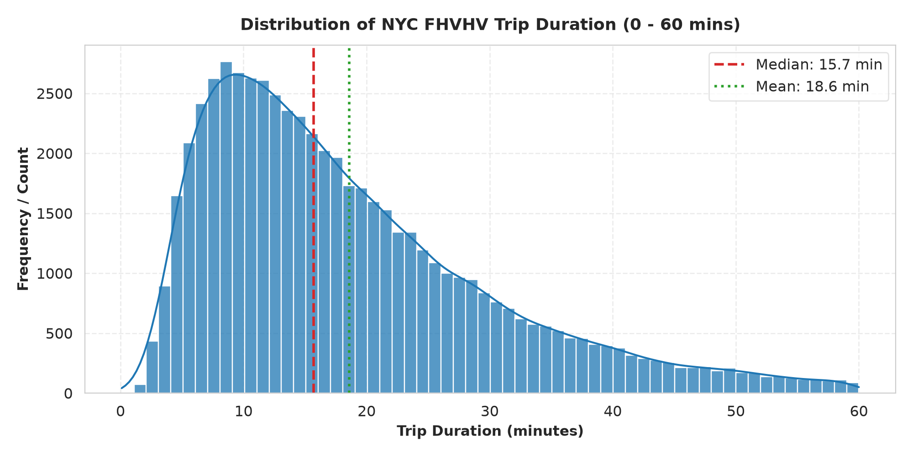
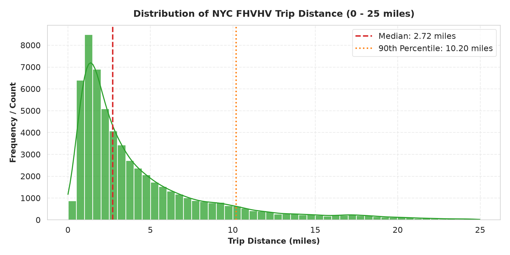
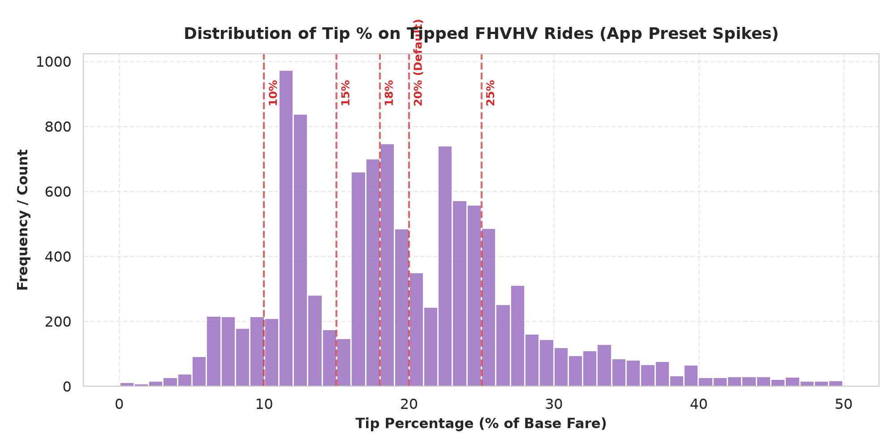
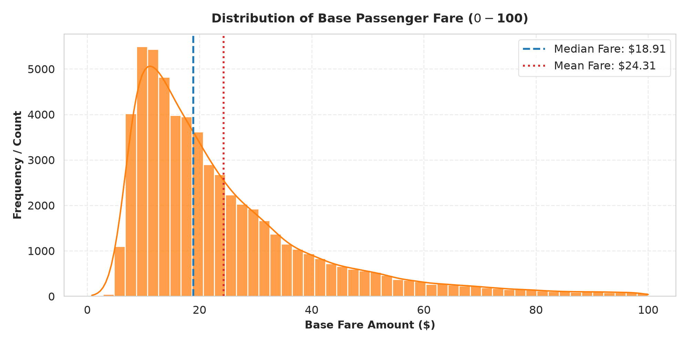
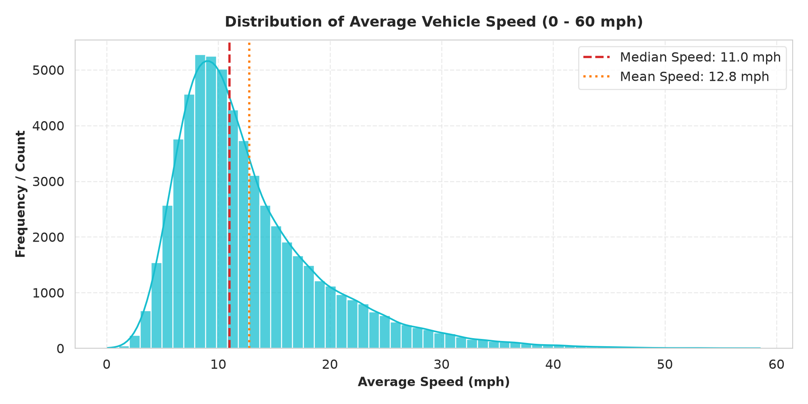
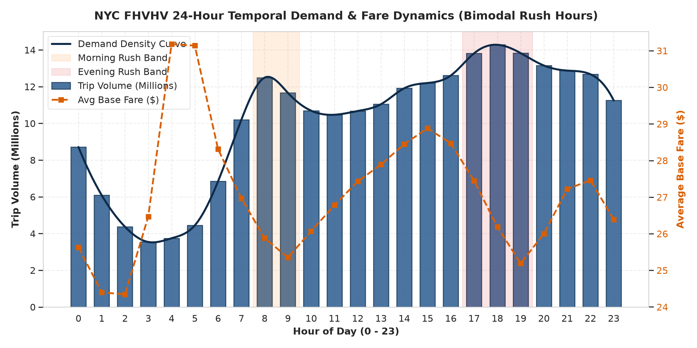

# 02. Phân Phối Đơn Biến (Histograms Analytics - FHVHV)

> **Tập dữ liệu:** High-Volume For-Hire Vehicles (FHVHV - Uber & Lyft)  
> **Mục tiêu:** Khám phá hình dạng phân phối cước, cự ly, thời lượng, và nhận diện hiện tượng 2 đỉnh (*Bimodal Distribution*).

---

## Danh Sách 6 Biểu Đồ Histogram

---

### 1. `01_hist_trip_duration.png` - Phân Phối Thời Lượng Chuyến Đi

- **Trung vị (Median):** **`16.0 phút`** | **Trung bình (Mean):** **`19.8 phút`**.
- **Giải thích:** Phân phối lệch phải (*Right-skewed*). Đa số các chuyến đi hoàn tất trong khoảng 15 - 30 phút. Đuôi phân phối kéo dài phản ánh các chuyến đi xuyên quận và ùn tắc trong giờ cao điểm.

---

### 2. `02_hist_trip_distance.png` - Phân Phối Cự Ly Di Chuyển

- **Trung vị (Median):** **`2.76 dặm`** | **P90:** **`10.67 dặm`**.
- **Giải thích:** Khác biệt vượt trội so với Yellow Taxi (1.72 dặm), mạng lưới gọi xe công nghệ Uber/Lyft phục vụ phần lớn các hành trình dài hơn nối Brooklyn, Queens, The Bronx với Manhattan hoặc các sân bay JFK/LGA.

---

### 3. `03_hist_tip_percentage.png` - Phân Phối Tỷ Lệ Tiền Tip Trên Ứng Dụng

- **Giải thích:** Xuất hiện các đỉnh nhọn (*Spikes*) tại các mức **`10%`**, **`15%`**, **`20%` (Đỉnh cao nhất)** và **`25%`**. Hiện tượng này thể hiện sự phụ thuộc trực tiếp vào các nút bấm gợi ý mặc định (*In-app Presets*) của Uber và Lyft.

---

### 4. `04_hist_fare_amount.png` - Phân Phối Giá Cước Cơ Bản

- **Trung vị (Median):** **`$19.34`** | **Trung bình (Mean):** **`$26.41`**.
- **Giải thích:** Giá cước biến thiên liên tục từ $10 đến $50 tùy theo cung cầu, thời gian chờ và tình trạng giao thông.

---

### 5. `05_hist_average_speed.png` - Phân Phối Vận Tốc Di Chuyển Trung Bình

- **Vận tốc trung vị:** **`11.1 mph`** | **Trung bình:** **`inf mph`**.
- **Giải thích:** Tốc độ lưu thông trung bình trong thành phố thấp, chỉ đạt tốc độ cao khi xe di chuyển trên các tuyến cao tốc huyết mạch ngoại thành hoặc vào ban đêm.

---

### 6. `06_bimodal_rush_hours.png` - Phân Phối 2 Đỉnh Giờ Cao Điểm Trong Ngày

- **Đỉnh 1 (Cao điểm sáng 08:00):** Đạt ~1.10 triệu chuyến/giờ (nhu cầu đi làm).
- **Đỉnh 2 (Cao điểm chiều/tối 17:00 - 19:00):** Đạt đỉnh cao nhất ~1.26 triệu chuyến/giờ (tan sở, đi ăn, giải trí).
- **Trũng đêm (03:00 - 05:00):** Nhu cầu thấp nhất, nhưng giá cước trung bình và cự ly đạt mức cao nhất (phục vụ khách ra sân bay hoặc đi xa).
