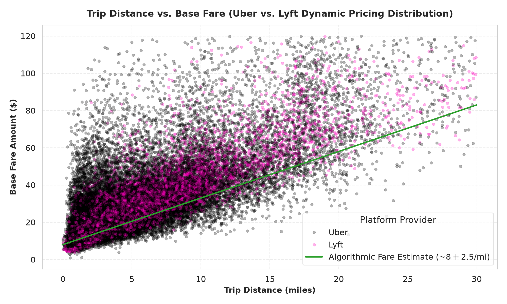
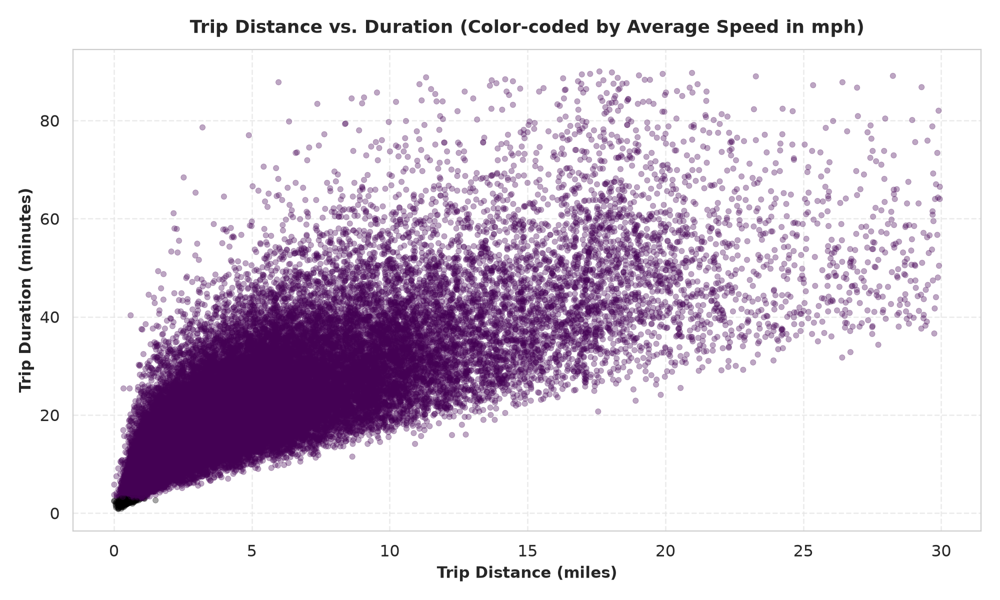
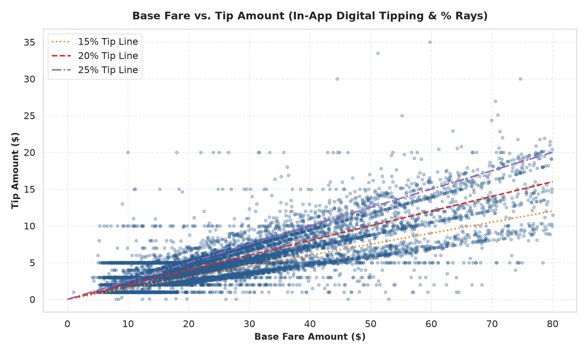
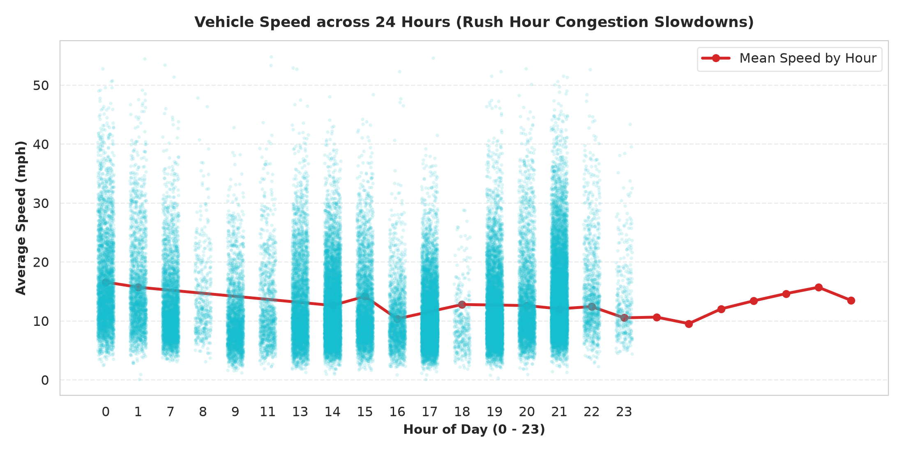

# 03. Tương Quan Đa Biến (Scatter Plots Analytics - FHVHV)

> **Tập dữ liệu:** High-Volume For-Hire Vehicles (FHVHV - Uber & Lyft)  
> **Mục tiêu:** Khám phá mối quan hệ tương quan giữa cự ly, giá cước động, tiền tip và tốc độ di chuyển theo thời gian.

---

## Danh Sách 4 Biểu Đồ Scatter Plot

---

### 1. `01_scatter_distance_vs_fare.png` - Cự Ly Di Chuyển vs. Giá Cước (Uber vs. Lyft)

- **Phân tách nền tảng:** Điểm đen đại diện cho Uber (HV0003) và hồng đại diện cho Lyft (HV0005).
- **Cơ chế định giá động (*Dynamic Pricing*):** Không có giá cước phẳng cứng nhắc như taxi truyền thống ($70 JFK); thay vào đó, giá cước phân tán thành dải rộng xung quanh đường dự đoán $8.00 + $2.50/mi, phản ánh hệ số nhân Surge Pricing khi cầu vượt cung.

---

### 2. `02_scatter_distance_vs_duration.png` - Cự Ly vs. Thời Gian Di Chuyển (Color theo Vận Tốc)

- **Phân cụm dữ liệu & Vận tốc:**
  - **Cụm màu tím/xanh đậm (Chậm < 10 mph):** Xe bị kẹt trong lõi trung tâm Manhattan hoặc giờ tan tầm.
  - **Cụm màu vàng/xanh sáng (Nhanh > 25 mph):** Các hành trình trên cao tốc nối các quận ngoại ô (Brooklyn, Queens, Staten Island).

---

### 3. `03_scatter_fare_vs_tip.png` - Giá Cước vs. Tiền Tip (Chùm Tia Tip In-App)

- **Phân tích chùm tia (*Ray Clusters*):**
  - Khi khách tip theo tỷ lệ phần trăm, các điểm dữ liệu phân bố thẳng hàng theo các dải tia **15%, 20%, 25%**.
  - Các đường ngang cố định phản ánh nhóm người dùng chọn tip số tiền tròn ($2, $5, $10).

---

### 4. `04_scatter_hour_vs_speed.png` - Khung Giờ Trong Ngày vs. Vận Tốc Di Chuyển

- **Chu kỳ 24 giờ:**
  - Tốc độ di chuyển cao nhất vào rạng sáng (02:00 - 05:00) với mức trung bình ~18 - 22 mph.
  - Tốc độ giảm sâu nhất vào giờ cao điểm buổi tối (17:00 - 19:00) xuống còn ~9 - 11 mph.
