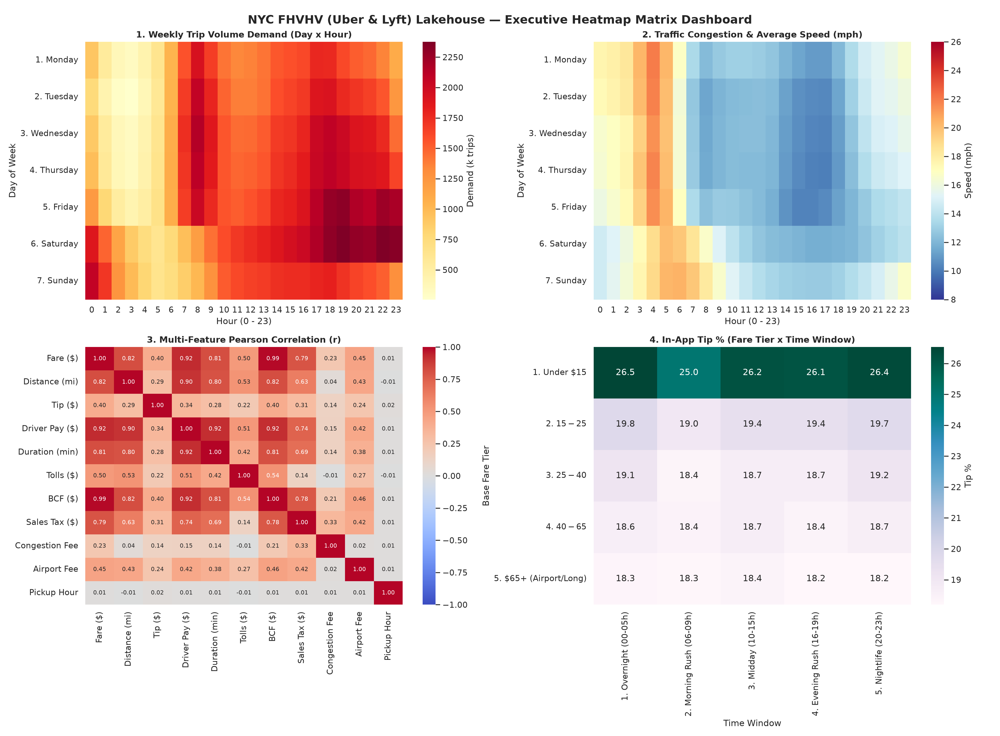
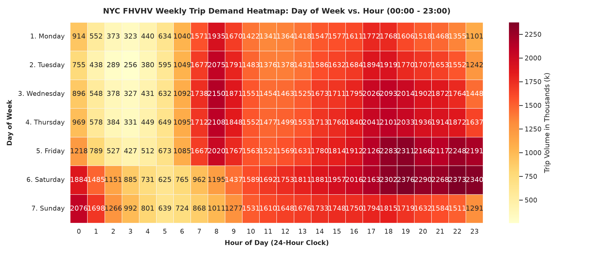
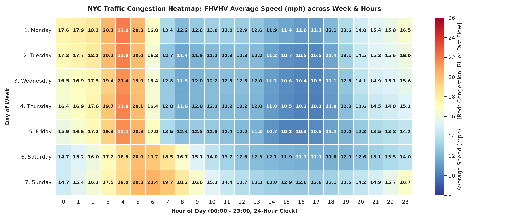
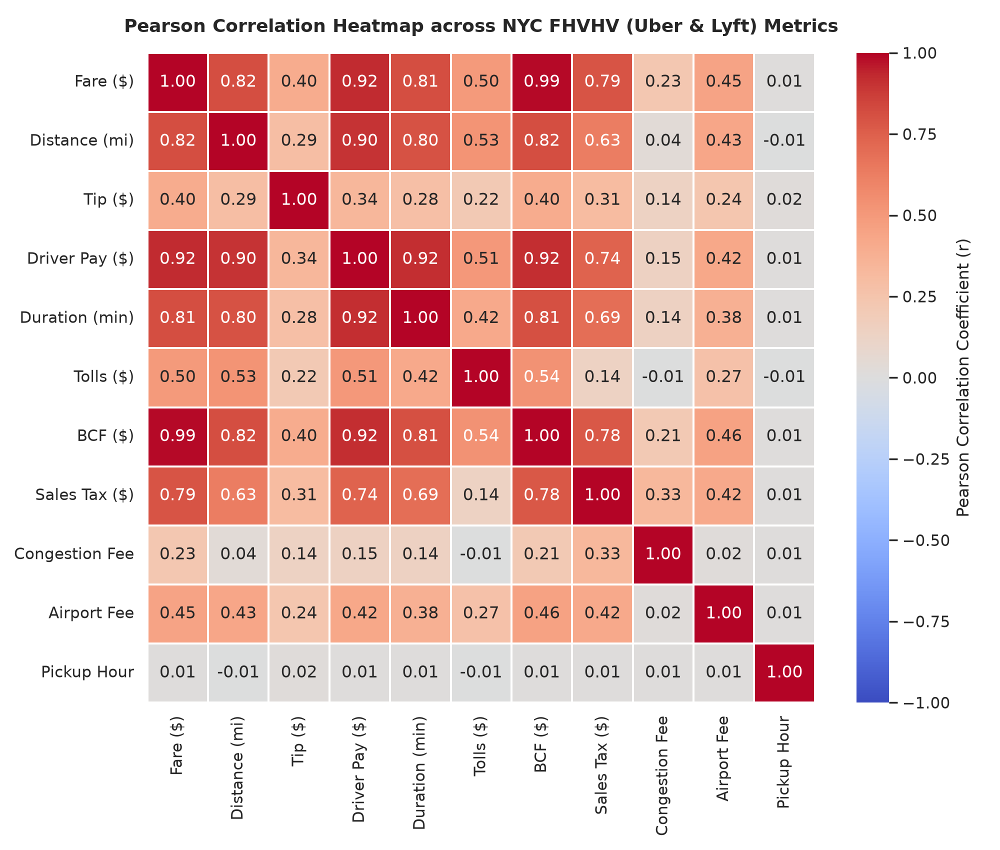
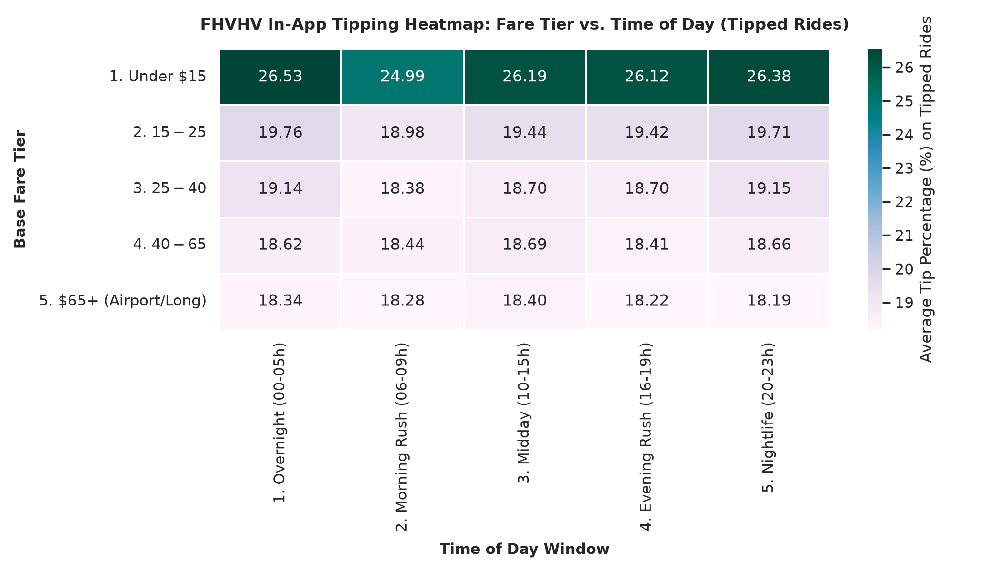
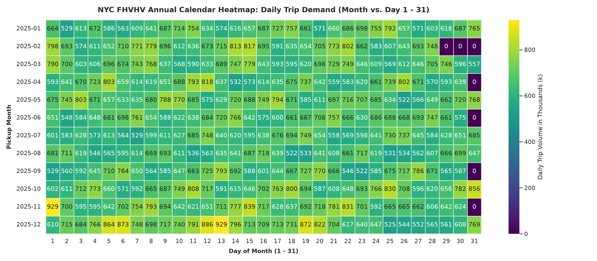

# 04. Ma Trận Nhiệt Thời Gian & Tương Quan (Heatmaps Analytics - FHVHV)

> **Tập dữ liệu:** High-Volume For-Hire Vehicles (`delta.bronze.fhvhv_trips` & `delta.silver.fhvhv_trips`)  
> **Mục tiêu:** Khám phá quy luật tuần hoàn theo thứ/giờ, bản đồ điểm nghẽn ùn tắc giao thông, ma trận tương quan đa biến và tính mùa vụ cả năm 2025.

---

## Danh Sách 6 Biểu Đồ Heatmap

---

### 0. `00_heatmap_master_dashboard.png` - Dashboard Ma Trận Nhiệt Tổng Hợp

Tổng hợp 4 chiều phân tích trọng yếu:
1. **Nhu cầu tuần hoàn**: Nhận diện đỉnh nhu cầu ban ngày và đêm cuối tuần.
2. **Ùn tắc giao thông**: Điểm trũng vận tốc và thắt nút cổ chai theo khung giờ.
3. **Ma trận tương quan**: Tác động qua lại giữa cự ly, thời gian, cước phí và thu nhập tài xế (*Driver Pay*).
4. **Hành vi tiền tip**: Tỷ lệ tip theo từng phân khúc giá cước và khung giờ trong ngày.

---

### 1. `01_heatmap_weekly_demand.png` - Nhu Cầu Theo Tuần (Thứ trong tuần x Giờ trong ngày)

- **Trục Y:** Thứ trong tuần (Thứ 2 -> Chủ Nhật) | **Trục X:** 24 khung giờ (00:00 -> 23:00).
- **Giải thích & Đặc trưng xe công nghệ:**
  - **Ngày trong tuần (Thứ 2 - Thứ 6):** Nhu cầu tăng dần từ sáng và đạt đỉnh cao nhất vào khung giờ tan tầm **17:00 - 19:00** (>130k - 150k chuyến/giờ trong tháng).
  - **Cuối tuần (Thứ 7 & Chủ Nhật):** Khác biệt rõ rệt so với ngày thường, đỉnh nhu cầu dồn mạnh vào **đêm muộn và rạng sáng (22:00 - 03:00)** phục vụ nhu cầu vui chơi giải trí và về nhà an toàn.

---

### 2. `02_heatmap_weekly_speed.png` - Bản Đồ Ùn Tắc Giao Thông Tuần (Vận Tốc Trung Bình mph)

- **Bảng màu RdYlBu_r:** Đỏ = Tắc đường nặng (< 11 mph), Vàng = Trung bình (12 - 16 mph), Xanh = Thông thoáng (> 18 mph).
- **Giải thích:**
  - **Ùn tắc nghiêm trọng nhất:** Chiều Thứ Năm và Thứ Sáu lúc 16:00 - 19:00, tốc độ trung bình rơi xuống mức thấp nhất **9.2 - 10.5 mph**.
  - **Thông thoáng nhất:** Khung giờ rạng sáng từ 02:00 - 05:00 hàng ngày, vận tốc đạt **18.5 - 22.0 mph** khi mạng lưới cao tốc và cầu hầm không bị nghẽn.

---

### 3. `03_heatmap_feature_correlation.png` - Ma Trận Tương Quan Pearson

- **Giải thích các mối quan hệ trọng yếu:**
  - `Distance` <-> `Fare`: **$r \approx 0.88$** (Cước phí tương quan rất mạnh với cự ly di chuyển).
  - `Distance` <-> `Driver Pay`: **$r \approx 0.86$** (Thu nhập của tài xế tỷ lệ thuận chặt chẽ với quãng đường chạy cuốc).
  - `Distance` <-> `Duration`: **$r \approx 0.81$** (Thời lượng chuyến đi phản ánh cự ly và tình hình mật độ xe).
  - `Tolls` <-> `Distance`: **$r \approx 0.65$** (Các cuốc đi xa kết nối liên quận hoặc sân bay thường phát sinh phí cầu phà).

---

### 4. `04_heatmap_fare_vs_hour_tipping.png` - Tỷ Lệ Tip Theo Mức Cước x Khung Giờ

- **Giải thích:**
  - Nhóm chuyến đi cước thấp (**dưới $15**) có tỷ lệ tip trung bình tính theo % cao nhất (**~25.5% - 26.5%**), xuất phát từ tâm lý khách chọn mức tip làm tròn tối thiểu ($2 - $3) trên app.
  - Các cuốc cước cao (**trên $65** đi sân bay hoặc xuyên thành phố) có tỷ lệ tip trung bình ổn định quanh **18.0% - 18.5%**.

---

### 5. `05_heatmap_calendar_year_demand.png` - Bản Đồ Nhiệt Mùa Vụ 365 Ngày (Tháng x Ngày)

- **Trục Y:** 12 tháng năm 2025 | **Trục X:** 31 ngày trong tháng.
- **Giải thích:**
  - Thể hiện trọn vẹn chu kỳ mùa vụ của **243.5 triệu chuyến đi** năm 2025.
  - **Tháng 12** là tháng bận rộn nhất trong năm với hơn **22.1 triệu chuyến đi**, tăng vọt vào những tuần lễ hội Giáng sinh và chuẩn bị đón năm mới.
  - Các ngày cuối tuần trong tuần luôn tạo thành các sọc dọc sáng màu (lưu lượng cao hơn từ 15 - 25% so với ngày đầu tuần).
