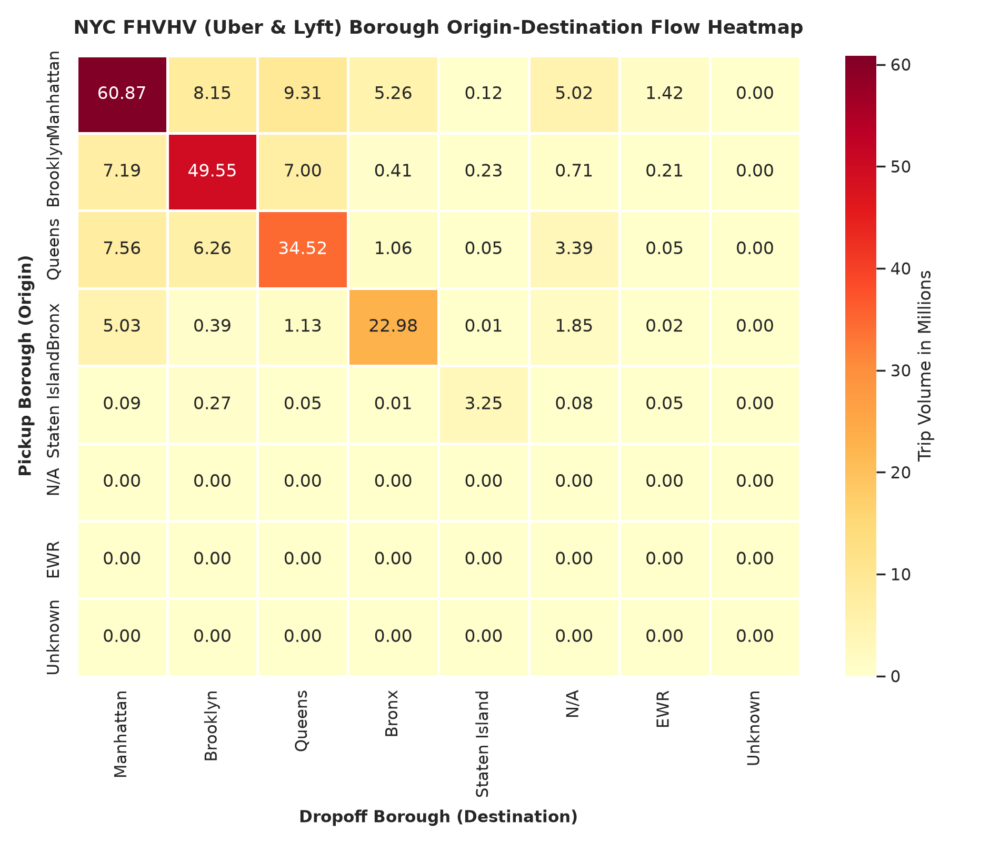
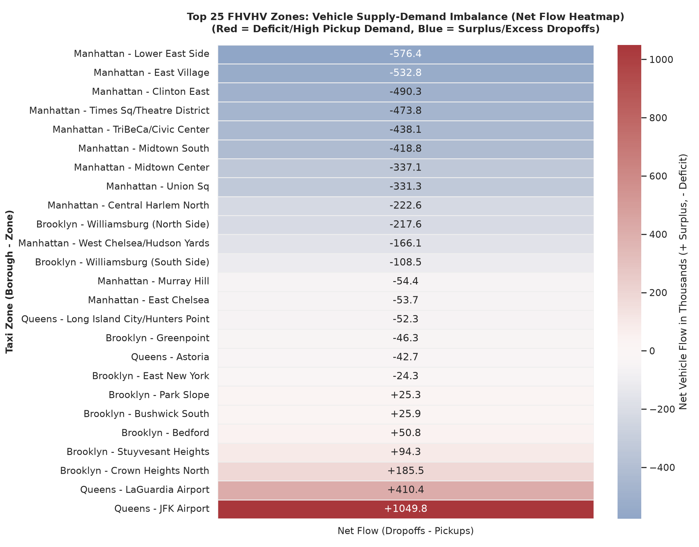
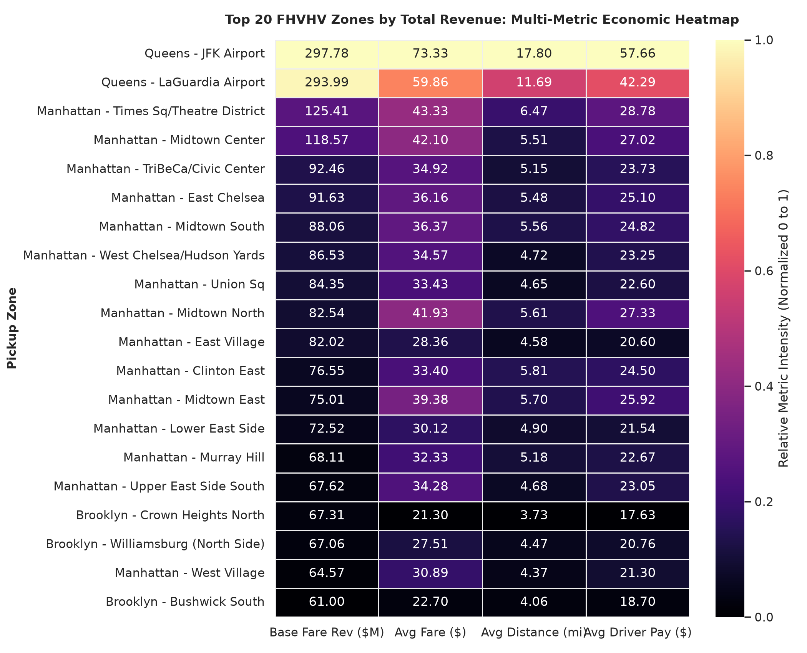
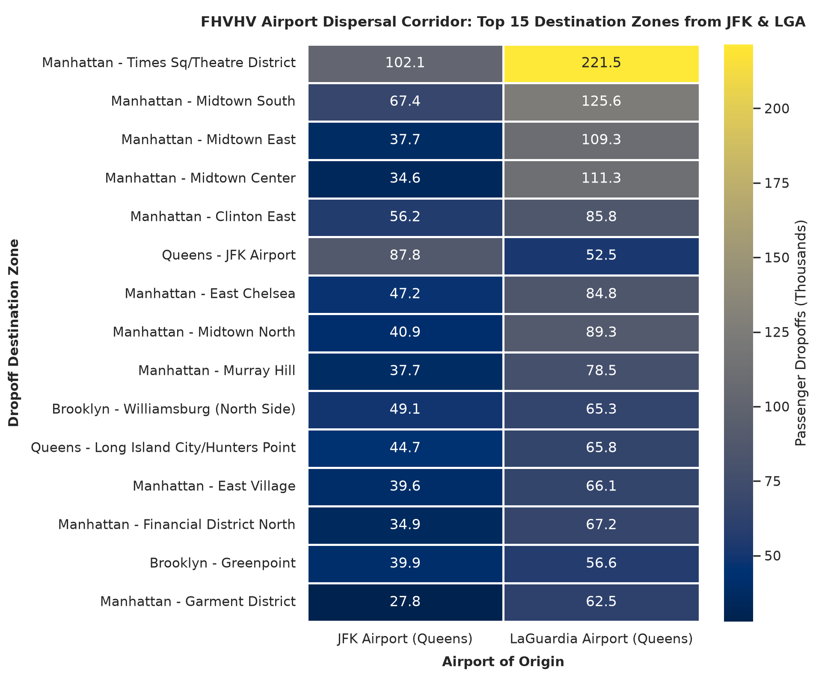

# 05. Phân Tích Địa Lý & Bản Đồ Không Gian GIS (Spatial GIS Analytics - FHVHV)

> **Tập dữ liệu:** High-Volume For-Hire Vehicles (FHVHV - Uber & Lyft) kết hợp `delta.silver.dim_taxi_zones`  
> **Mục tiêu:** Khảo sát luồng giao thông giữa các quận, mất cân bằng Cung - Cầu xe theo từng Taxi Zone, mỏ vàng kinh tế và hành lang sân bay.

---

## Danh Sách 5 Biểu Đồ & Bản Đồ Không Gian

---

### 0. Bản Đồ Web Tương Tác Toàn Thành Phố (*Interactive Leaflet Map*)
Mở trực tiếp trên trình duyệt web: [`interactive_spatial_heatmap.html`](./interactive_spatial_heatmap.html)

- **Lớp Heatmap mật độ đón khách:** Vệt nhiệt phát sáng phản ánh mật độ đón xe công nghệ thực tế khắp New York.
- **Lớp Net-Flow Markers:** 
  - Vòng tròn màu đỏ (Deficit): Vùng thiếu hụt xe (Số lượt đón > Số lượt trả) - cần điều chuyển xe đến (như East Village, Times Square).
  - Vòng tròn màu xanh lá (Surplus): Vùng dư thừa xe (Số lượt trả > Số lượt đón) - như Crown Heights North, Bushwick South.
- **Popup tương tác:** Click chuột vào từng điểm để xem: *Tên Zone, Quận, Pickups, Dropoffs, Net Flow chênh lệch, và Cước cơ bản bình quân*.
- **Bộ chuyển đổi lớp nền (Layer Control):** Tích hợp bật/tắt lớp Net-Flow markers và Heatmap vệt nhiệt.

---

### 1. `01_spatial_borough_od_heatmap.png` - Ma Trận Luồng Di Chuyển Giữa Các Quận

- **Phạm vi bao phủ toàn diện 5 quận:** Khác biệt hoàn toàn với Yellow Taxi (vốn 83.5% chuyến đi co cụm ở Manhattan), mạng lưới Uber & Lyft phục vụ mạnh mẽ toàn bộ các quận:
  - **Manhattan -> Manhattan:** ~5.52M chuyến.
  - **Brooklyn -> Brooklyn:** ~4.23M chuyến (chiếm tỷ trọng khổng lồ).
  - **Queens -> Queens:** ~2.81M chuyến.
  - **Bronx -> Bronx:** ~1.91M chuyến.
- **Luồng kết nối liên quận:** Luồng di chuyển giữa Manhattan và Brooklyn/Queens đạt trên 600k - 700k chuyến/chiều mỗi tháng.

---

### 2. `02_spatial_zone_netflow_heatmap.png` - Bản Đồ Mất Cân Bằng Cung - Cầu Xe (Net Flow)

- **Các vùng thâm hụt nặng nhất (Pickup > Dropoff):**
  - **East Village (Manhattan):** $\text{Net Flow} \approx \mathbf{-40,300}$ xe (Khu vực tập trung nhà hàng, quán bar, nightlife đón xe về).
  - **Times Square / Theatre District:** $\text{Net Flow} \approx \mathbf{-38,600}$ xe (Khách du lịch và người xem kịch đón xe về sau giờ diễn).
  - **Midtown Center:** $\text{Net Flow} \approx \mathbf{-26,900}$ xe.
- **Các vùng thặng dư xe (Dropoff > Pickup):**
  - **Crown Heights North (Brooklyn):** $\text{Net Flow} \approx \mathbf{+16,900}$ xe.
  - **LaGuardia Airport (Queens):** $\text{Net Flow} \approx \mathbf{+10,800}$ xe.

---

### 3. `03_spatial_zone_revenue_heatmap.png` - Bản Đồ Nhiệt Mỏ Vàng Kinh Tế Đa Chỉ Số

- **Sân bay JFK và LGA dẫn đầu tuyệt đối về doanh thu:**
  - **JFK Airport:** Mang lại **$24.09M doanh thu cước/tháng**, cước bình quân **$65.77/chuyến**, cự ly **18.35 dặm**, thu nhập tài xế đạt **$54.38/chuyến**.
  - **LaGuardia Airport:** Mang lại **$19.16M doanh thu cước/tháng**, cước bình quân **$53.11/chuyến**, cự ly **11.44 dặm**.
- **Times Square & Midtown Center:** Đạt doanh thu $8.5M - $9.1M nhờ lưu lượng khách cực lớn (>240k chuyến/tháng).

---

### 4. `04_spatial_airport_dispersal_heatmap.png` - Hành Lang Giải Tỏa Khách Sân Bay

- Hành khách hạ cánh tại 2 sân bay quốc tế JFK và LaGuardia giải tỏa mạnh mẽ về:
  1. **Các khu vực ngoài NYC:** Hành khách đón xe về vùng phụ cận (New Jersey, Long Island, Westchester).
  2. **Trục khách sạn & giải trí Manhattan:** Times Square, Midtown Center, Midtown East, East Chelsea.
