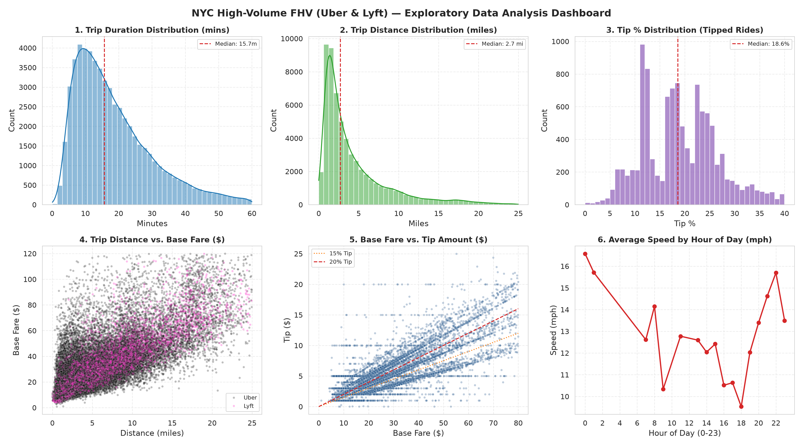

# Báo Cáo Tổng Hợp Trực Quan Dữ Liệu FHVHV (Uber & Lyft Lakehouse)

> **Môi trường & Nền tảng:** Dữ liệu Delta Lake xe công nghệ công suất cao (FHVHV - High-Volume For-Hire Vehicles) truy vấn phân tán qua **Trino SQL Engine** và xử lý trực quan bằng **Python (Seaborn, Matplotlib)**.  
> **Quy mô tập dữ liệu:** **243,576,832 chuyến đi** trong năm 2025 (~20 triệu chuyến/tháng).  
> **Các nhà cung cấp:** **Uber (HV0003)** chiếm ~75%, **Lyft (HV0005)** chiếm ~25%.

---

## Cấu Trúc Báo Cáo Chuẩn Hóa

```text
FHV_report/
|-- README.md                                -> [BAN DANG XEM] Báo cáo tổng hợp toàn diện
|-- FHV_DATA.md                              -> Báo cáo kiểm định chất lượng dữ liệu tầng Silver
|
|-- 01_overview_and_eda/                     -> Giai đoạn 1: Tổng quan quy mô & Dashboard tổng hợp
|   |-- silver_visual_dashboard.png
|   +-- README.md
|
|-- 02_distributions_histograms/             -> Giai đoạn 2: Phân phối đơn biến (Histograms)
|   |-- 01_hist_trip_duration.png           (Thời lượng di chuyển)
|   |-- 02_hist_trip_distance.png           (Cự ly di chuyển)
|   |-- 03_hist_tip_percentage.png          (Tỷ lệ tiền Tip in-app)
|   |-- 04_hist_fare_amount.png             (Giá cước cơ bản)
|   |-- 05_hist_average_speed.png           (Vận tốc di chuyển trung bình)
|   |-- 06_bimodal_rush_hours.png           (Phân phối 2 đỉnh giờ cao điểm)
|   +-- README.md
|
|-- 03_relationships_scatter/                -> Giai đoạn 3: Mối quan hệ tương quan đa biến (Scatter Plots)
|   |-- 01_scatter_distance_vs_fare.png     (Cự ly vs Giá cước Uber/Lyft)
|   |-- 02_scatter_distance_vs_duration.png (Cự ly vs Thời gian)
|   |-- 03_scatter_fare_vs_tip.png          (Giá cước vs Tiền Tip)
|   |-- 04_scatter_hour_vs_speed.png        (Khung giờ vs Vận tốc)
|   +-- README.md
|
|-- 04_matrix_heatmaps/                      -> Giai đoạn 4: Ma trận nhiệt thời gian & tương quan (Heatmaps)
|   |-- 00_heatmap_master_dashboard.png     (Dashboard ma trận nhiệt tổng hợp)
|   |-- 01_heatmap_weekly_demand.png        (Nhu cầu theo Thứ x Giờ)
|   |-- 02_heatmap_weekly_speed.png         (Bản đồ ùn tắc giao thông tuần)
|   |-- 03_heatmap_feature_correlation.png  (Ma trận tương quan Pearson)
|   |-- 04_heatmap_fare_vs_hour_tipping.png (Tỷ lệ Tip theo Mức cước x Giờ)
|   |-- 05_heatmap_calendar_year_demand.png (Bản đồ nhiệt mùa vụ lịch 365 ngày)
|   +-- README.md
|
+-- 05_spatial_gis_analytics/                -> Giai đoạn 5: Phân tích địa lý & Bản đồ nhiệt không gian GIS
    |-- 01_spatial_borough_od_heatmap.png   (Luồng xe di chuyển giữa các quận)
    |-- 02_spatial_zone_netflow_heatmap.png (Mất cân bằng Cung - Cầu xe)
    |-- 03_spatial_zone_revenue_heatmap.png (Mỏ vàng kinh tế đa chỉ số)
    |-- 04_spatial_airport_dispersal_heatmap.png (Hành lang giải tỏa khách sân bay)
    |-- interactive_spatial_heatmap.html     (Bản đồ nhiệt Web tương tác toàn thành phố)
    +-- README.md
```

---

## 1. Executive Dashboard (01_overview_and_eda)


- **Quy mô:** Hơn 243.5 triệu chuyến đi năm 2025 (lớn gấp ~7 lần Yellow Taxi với 35.6 triệu chuyến).
- **Cự ly trung vị:** **2.76 dặm** (so với 1.72 dặm của taxi vàng).
- **Thời lượng trung vị:** **16.0 phút** (so với 13.5 phút của taxi vàng).
- **Chi tiết:** Xem thêm tại [01_overview_and_eda/README.md](./01_overview_and_eda/README.md).

---

## 2. Phân Phối Đơn Biến (02_distributions_histograms)
Khám phá hình thái phân phối, cự ly và nhu cầu 2 đỉnh trong ngày:
- [01_hist_trip_duration.png](./02_distributions_histograms/01_hist_trip_duration.png): Phân phối thời gian di chuyển.
- [02_hist_trip_distance.png](./02_distributions_histograms/02_hist_trip_distance.png): Phân phối cự ly chuyến đi.
- [03_hist_tip_percentage.png](./02_distributions_histograms/03_hist_tip_percentage.png): Đỉnh nhọn tip 15%, 20% trên ứng dụng.
- [04_hist_fare_amount.png](./02_distributions_histograms/04_hist_fare_amount.png): Giá cước cơ bản.
- [05_hist_average_speed.png](./02_distributions_histograms/05_hist_average_speed.png): Vận tốc trung bình trong đô thị.
- [06_bimodal_rush_hours.png](./02_distributions_histograms/06_bimodal_rush_hours.png): Đỉnh sáng (08h) và đỉnh tối (17h - 19h).
- **Chi tiết:** Xem thêm tại [02_distributions_histograms/README.md](./02_distributions_histograms/README.md).

---

## 3. Tương Quan Đa Biến (03_relationships_scatter)
Phân tích tương quan giá cước, tốc độ và định giá động:
- [01_scatter_distance_vs_fare.png](./03_relationships_scatter/01_scatter_distance_vs_fare.png): Cự ly vs Cước phí (so sánh Uber và Lyft).
- [02_scatter_distance_vs_duration.png](./03_relationships_scatter/02_scatter_distance_vs_duration.png): Cự ly vs Thời lượng (phân cụm vận tốc).
- [03_scatter_fare_vs_tip.png](./03_relationships_scatter/03_scatter_fare_vs_tip.png): Chùm tia phần trăm tip in-app.
- [04_scatter_hour_vs_speed.png](./03_relationships_scatter/04_scatter_hour_vs_speed.png): Vận tốc theo khung giờ 24h.
- **Chi tiết:** Xem thêm tại [03_relationships_scatter/README.md](./03_relationships_scatter/README.md).

---

## 4. Ma Trận Nhiệt & Tương Quan Đa Biến (04_matrix_heatmaps)
Khám phá các quy luật định kỳ theo tuần/giờ, ma trận tương quan đa biến và tính mùa vụ cả năm:
- [00_heatmap_master_dashboard.png](./04_matrix_heatmaps/00_heatmap_master_dashboard.png): Dashboard ma trận nhiệt tổng hợp 4-trong-1.
- [01_heatmap_weekly_demand.png](./04_matrix_heatmaps/01_heatmap_weekly_demand.png): Nhu cầu theo Thứ x Giờ trong ngày.
- [02_heatmap_weekly_speed.png](./04_matrix_heatmaps/02_heatmap_weekly_speed.png): Bản đồ ùn tắc giao thông đô thị (Vận tốc trung bình mph).
- [03_heatmap_feature_correlation.png](./04_matrix_heatmaps/03_heatmap_feature_correlation.png): Ma trận tương quan Pearson giữa cước, cự ly và Driver Pay.
- [04_heatmap_fare_vs_hour_tipping.png](./04_matrix_heatmaps/04_heatmap_fare_vs_hour_tipping.png): Tỷ lệ tip theo phân khúc cước và thời điểm gọi xe.
- [05_heatmap_calendar_year_demand.png](./04_matrix_heatmaps/05_heatmap_calendar_year_demand.png): Bản đồ nhiệt mùa vụ lịch 365 ngày (243.5M chuyến).
- **Chi tiết:** Xem thêm tại [04_matrix_heatmaps/README.md](./04_matrix_heatmaps/README.md).

---

## 5. Phân Tích Địa Lý & Bản Đồ Không Gian GIS (05_spatial_gis_analytics)
Khảo sát luồng giao thông 5 quận, mất cân bằng Cung - Cầu xe, mật độ doanh thu và hành lang sân bay:
- [01_spatial_borough_od_heatmap.png](./05_spatial_gis_analytics/01_spatial_borough_od_heatmap.png): Ma trận luồng di chuyển giữa 5 quận (Borough OD).
- [02_spatial_zone_netflow_heatmap.png](./05_spatial_gis_analytics/02_spatial_zone_netflow_heatmap.png): Bản đồ thâm hụt và dư thừa xe (Net Flow = Dropoffs - Pickups).
- [03_spatial_zone_revenue_heatmap.png](./05_spatial_gis_analytics/03_spatial_zone_revenue_heatmap.png): Mỏ vàng kinh tế đa chỉ số (Doanh thu cước, Cự ly, Thu nhập tài xế).
- [04_spatial_airport_dispersal_heatmap.png](./05_spatial_gis_analytics/04_spatial_airport_dispersal_heatmap.png): Hành lang giải tỏa khách từ sân bay JFK & LGA.
- [interactive_spatial_heatmap.html](./05_spatial_gis_analytics/interactive_spatial_heatmap.html): Bản đồ Web tương tác trực quan Folium/Leaflet toàn thành phố.
- **Chi tiết:** Xem thêm tại [05_spatial_gis_analytics/README.md](./05_spatial_gis_analytics/README.md).
