# Báo Cáo Tổng Hợp & Hệ Thống Hóa Trực Quan Dữ Liệu Tầng Silver (NYC Taxi Lakehouse)

> **Môi trường & Nền tảng:** Dữ liệu Delta Lake đã làm sạch tại tầng Silver (`delta.silver.yellow_trips` và `delta.silver.dim_taxi_zones`), truy vấn phân tán qua **Trino SQL Engine** và xử lý trực quan bằng **Python (Seaborn, Matplotlib, Folium GIS)**.  
> **Quy mô tập dữ liệu:** **35,611,613 chuyến đi sạch** (366 ngày, 262 Taxi Zones, doanh thu ~$1.05 tỷ USD).

---

## Cấu Trúc Thư Mục & Trình Tự Báo Cáo Chuẩn Hóa

Toàn bộ biểu đồ và báo cáo phân tích được sắp xếp theo đúng chu trình khoa học dữ liệu (Data Analysis Lifecycle):

```text
YLC_report/
|-- README.md                                -> [BAN DANG XEM] Báo cáo tổng hợp toàn diện
|
|-- 01_overview_and_eda/                     -> Giai đoạn 1: Tổng quan quy mô & Dashboard tổng hợp
|   +-- silver_visual_dashboard.png
|
|-- 02_distributions_histograms/             -> Giai đoạn 2: Khám phá phân phối đơn biến (Histograms)
|   |-- 01_hist_trip_duration.png           (Thời lượng di chuyển)
|   |-- 02_hist_trip_distance.png           (Cự ly di chuyển)
|   |-- 03_hist_tip_percentage.png          (Tỷ lệ tiền Tip trên thẻ)
|   |-- 04_hist_fare_amount.png             (Giá cước cơ bản)
|   |-- 05_hist_average_speed.png           (Vận tốc di chuyển trung bình)
|   +-- 06_bimodal_rush_hours.png           (Phân phối 2 đỉnh giờ cao điểm)
|
|-- 03_relationships_scatter/                -> Giai đoạn 3: Mối quan hệ tương quan đa biến (Scatter Plots)
|   |-- 01_scatter_distance_vs_fare.png     (Cự ly vs Giá cước)
|   |-- 02_scatter_distance_vs_duration.png (Cự ly vs Thời gian)
|   |-- 03_scatter_fare_vs_tip.png          (Giá cước vs Tiền Tip)
|   +-- 04_scatter_hour_vs_speed.png        (Khung giờ vs Vận tốc)
|
|-- 04_matrix_heatmaps/                      -> Giai đoạn 4: Ma trận nhiệt thời gian & tương quan (Heatmaps)
|   |-- 00_heatmap_master_dashboard.png     (Dashboard ma trận nhiệt tổng hợp)
|   |-- 01_heatmap_weekly_demand.png        (Nhu cầu theo Thứ x Giờ)
|   |-- 02_heatmap_weekly_speed.png         (Bản đồ ùn tắc giao thông tuần)
|   |-- 03_heatmap_feature_correlation.png  (Ma trận tương quan Pearson)
|   |-- 04_heatmap_fare_vs_hour_tipping.png (Tỷ lệ Tip theo Mức cước x Giờ)
|   +-- 05_heatmap_calendar_year_demand.png (Bản đồ nhiệt mùa vụ 365 ngày)
|
|-- 05_spatial_gis_analytics/                -> Giai đoạn 5: Phân tích địa lý & Bản đồ nhiệt không gian GIS
|   |-- 01_spatial_borough_od_heatmap.png   (Luồng xe di chuyển giữa các quận)
|   |-- 02_spatial_zone_netflow_heatmap.png (Mất cân bằng Cung - Cầu xe)
|   |-- 03_spatial_zone_revenue_heatmap.png (Mỏ vàng kinh tế đa chỉ số)
|   |-- 04_spatial_airport_dispersal_heatmap.png (Hành lang giải tỏa khách sân bay)
|   +-- interactive_spatial_heatmap.html     (Bản đồ nhiệt Web tương tác toàn thành phố)
|
+-- 06_weather_forecast_models/              -> Giai đoạn 6: Mô hình dự báo Nhu cầu & Doanh thu theo Thời tiết
    |-- README.md                           (Báo cáo phân tích tương quan thời tiết)
    |-- forecast_validation_metrics.json     (Báo cáo chỉ số lỗi & Feature Importance)
    |-- forecast_24h_dashboard.png           (Dashboard dự báo 24h đối soát với thời tiết)
    |-- forecast_72h_evaluation.png          (Đánh giá kiểm thử 72h mùa đông Actual vs Predicted)
    |-- weather_condition_impact.png         (Tác động của trạng thái thời tiết tới nhu cầu)
    +-- weather_correlation_matrix.png       (Ma trận tương quan biến thời tiết & taxi)
```

---

## Giai Đoạn 1: Tổng Quan Quy Mô & Executive Dashboard

### 1.1 Dashboard Phân Tích 6-trong-1
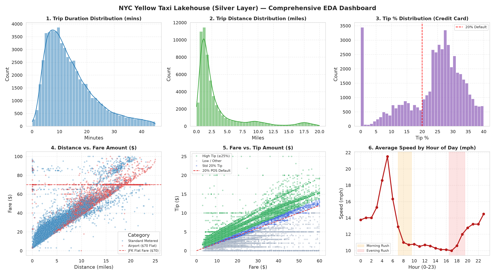

- **Tổng số chuyến đi:** **35,611,613 chuyến** (toàn bộ năm 2025).
- **Tổng doanh thu:** **$1,051,466,606.39** (~1.05 tỷ USD).
- **Phương thức thanh toán chủ đạo:** Thẻ tín dụng chiếm **85.9%** (tạo nguồn tiền tip minh bạch).
- **Thời lượng di chuyển trung vị:** **13.5 phút** (Cự ly trung vị: **1.72 dặm**).

---

## Giai Đoạn 2: Khám Phá Phân Phối Đơn Biến (Histograms)

Histogram giúp tìm hiểu hình dạng phân phối (*Skewness*), vị trí trung tâm (*Median/Mode*), và phát hiện các nhóm đối tượng tiềm ẩn (*Sub-populations*).

---

### 2.1 Phân phối thời lượng chuyến đi (*Trip Duration*)
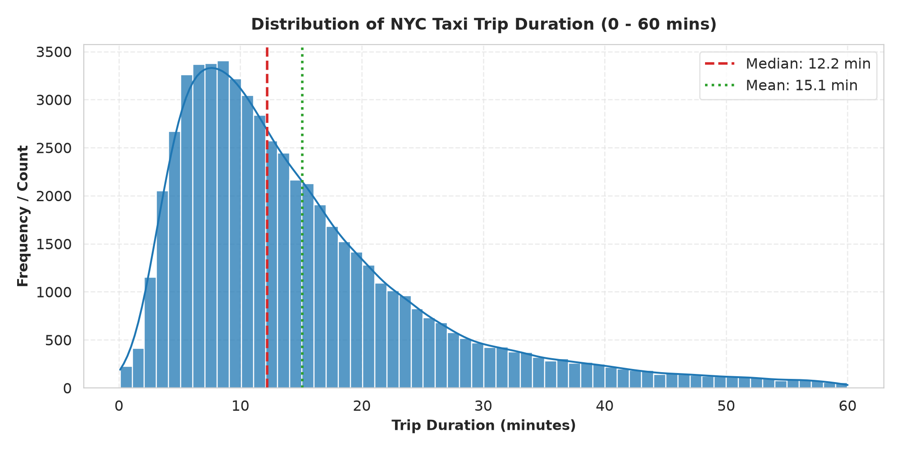
- **Trung vị (Median):** **`13.5 phút`** | **Trung bình (Mean):** **`17.2 phút`**.
- **Giải thích:** Phân phối lệch phải (*Right-skewed*). Hơn 85% chuyến đi kết thúc dưới 25 phút. Đuôi phân phối kéo dài đến 60 phút đại diện cho các chuyến đi bị kẹt xe nặng vào giờ tan tầm hoặc di chuyển liên quận vượt sông.

---

### 2.2 Phân phối cự ly di chuyển (*Trip Distance*)
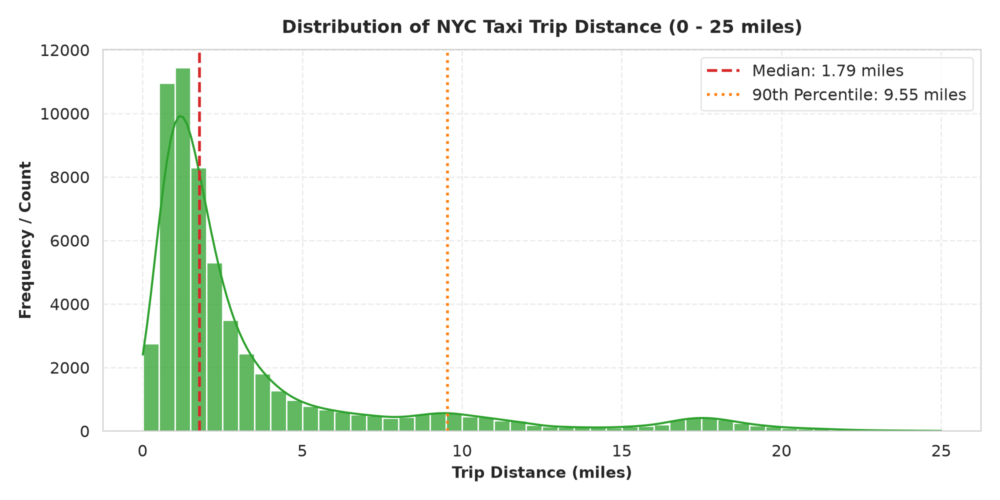
- **Trung vị (Median):** **`1.72 dặm (~2.77 km)`** | **P90:** **`14.72 dặm`**.
- **Giải thích:** Dữ liệu thể hiện rõ 2 phân khúc:
  1. **Cụm nội đô ngắn (0.5 - 3.5 dặm):** Chiếm >70% lưu lượng, phục vụ nhu cầu di chuyển nhanh trong trung tâm.
  2. **Gờ phụ sân bay (12.0 - 18.0 dặm):** Tương ứng với khoảng cách địa lý thực tế từ Manhattan đi sân bay LaGuardia (~10 dặm) và sân bay JFK (~16 dặm).

---

### 2.3 Phân phối tỷ lệ tiền Tip trên thẻ tín dụng (*Tip Percentage*)
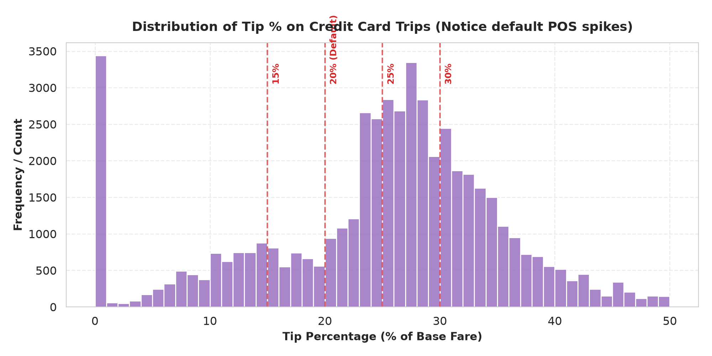
- **Giải thích:** Xuất hiện **4 đỉnh nhọn sắc nét (Spikes)** tại đúng các mốc: **`15%`**, **`20%` (Đỉnh cao nhất)**, **`25%`**, và **`30%`**.
- **Ý nghĩa tâm lý học:** Khách hàng có xu hướng bấm chọn nhanh các nút gợi ý có sẵn trên màn hình máy POS quẹt thẻ thay vì tự nhập số lẻ.

---

### 2.4 Phân phối giá cước cơ bản (*Base Fare Amount*)
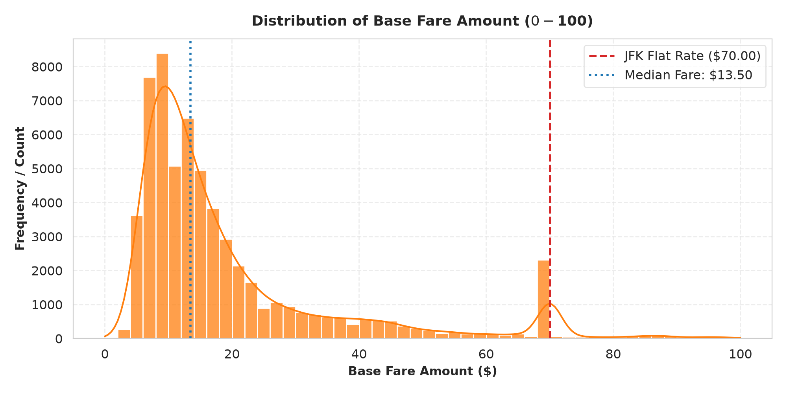
- **Trung vị (Median):** **`$13.48`** | **Trung bình (Mean):** **`$19.75`**.
- **Giải thích:** Đồ thị xuất hiện cột đỉnh nhọn riêng biệt tại mốc **`$70.00`** - phản ánh quy định cước trọn gói cố định (*Flat Rate*) của NYC cho tuyến Manhattan -> Sân bay JFK.

---

### 2.5 Phân phối vận tốc di chuyển trung bình (*Average Speed*)
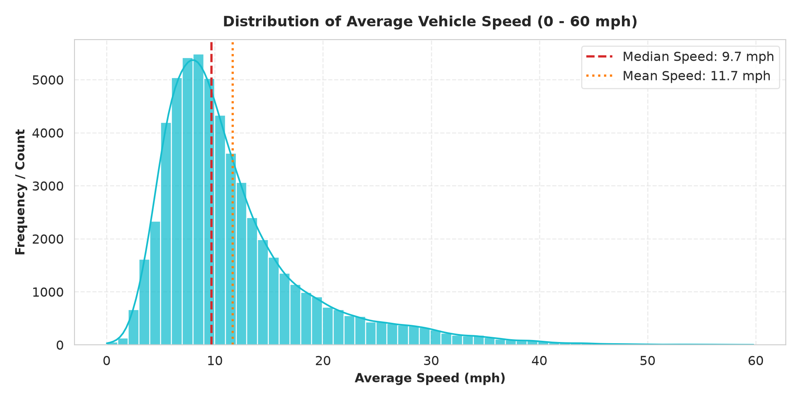
- **Vận tốc trung vị:** **`11.8 mph (~19.0 km/h)`**.
- **Giải thích:** Tốc độ lưu thông đô thị thấp do mạng lưới đèn đỏ dày đặc. Vận tốc > 30 mph chỉ xuất hiện vào ban đêm hoặc trên các tuyến cao tốc ven sông.

---

### 2.6 Phân phối 2 Đỉnh giờ cao điểm trong ngày (*Bimodal Rush Hours*)
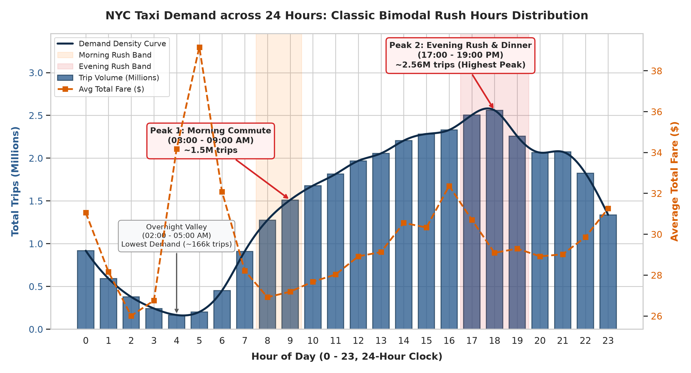
- **Đỉnh 1 (Cao điểm sáng 08:00 - 09:00):** Đạt **~1.51 triệu chuyến/giờ** (đi làm).
- **Đỉnh 2 (Cao điểm chiều/tối 17:00 - 19:00):** Đạt đỉnh cao nhất **~2.56 triệu chuyến/giờ** (tan sở + ăn tối, giải trí).
- **Trũng đêm (02:00 - 05:00):** Nhu cầu chạm đáy (166k chuyến), nhưng cước bình quân lại cao nhất ($34 - $39) do chủ yếu là chuyến đi xa hoặc ra sân bay đón chuyến sớm.

---

## Giai Đoạn 3: Khám Phá Mối Quan Hệ Tương Quan (Scatter Plots)

Scatter Plot giúp trực quan hóa quan hệ giữa 2 biến định lượng, nhận diện đường xu hướng (*Trend line*), phân cụm (*Clustering*) và phát hiện dị biệt (*Outliers*).

---

### 3.1 Cự ly di chuyển vs. Giá cước cơ bản (*Distance vs. Fare*)
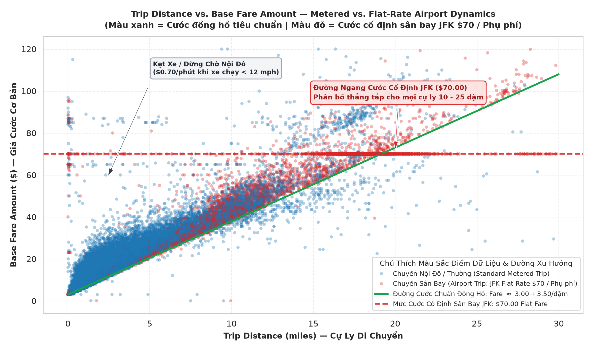
- **Đường dốc tuyến tính (Màu xanh):** Công thức tính cước chuẩn đồng hồ: $\text{Fare} \approx \$3.00 + \$3.50 \times \text{Distance}$.
- **Đường nằm ngang (Màu đỏ tại $70.00):** Cước cố định sân bay JFK áp dụng cho mọi cự ly từ 10 đến 25 dặm.
- **Các điểm nằm lệch lên trên:** Các chuyến đi cự ly ngắn nhưng kẹt xe dừng chờ lâu ($0.70/phút khi xe chạy dưới 12 mph).

---

### 3.2 Cự ly vs. Thời gian di chuyển (*Distance vs. Duration*)
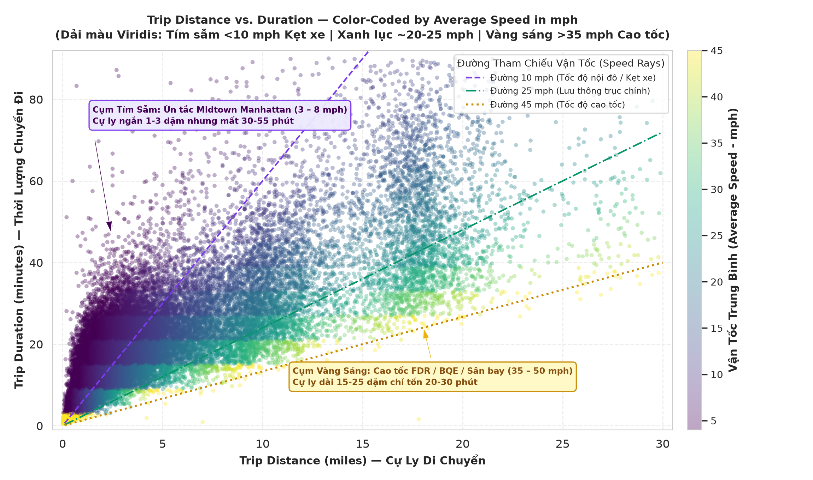
- **Cụm màu tím/xanh đậm (Chậm 3 - 8 mph):** Kẹt xe nội đô (quãng đường ngắn 1 - 3 dặm nhưng mất 30 - 55 phút).
- **Cụm màu vàng/xanh sáng (Nhanh 30 - 50 mph):** Chạy trên cao tốc (cự ly dài 15 - 22 dặm nhưng chỉ tốn 20 - 30 phút).

---

### 3.3 Giá cước vs. Tiền Tip (*Fare Amount vs. Tip Amount*)
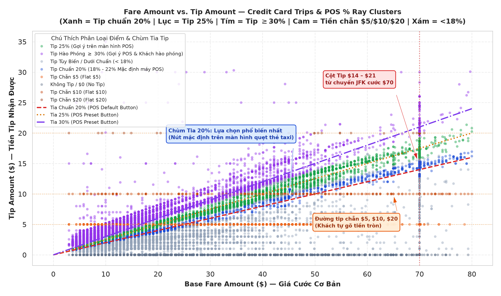
- **Hiện tượng chùm tia:** Dữ liệu phân tách thành 3 tia bám sát mốc **20%, 25%, và 30%**. Khi cước càng lớn (chuyến đi xa/sân bay), tiền tip nhận được càng cao ($14 - $21).

---

### 3.4 Khung giờ trong ngày vs. Vận tốc di chuyển (*Hour vs. Speed*)
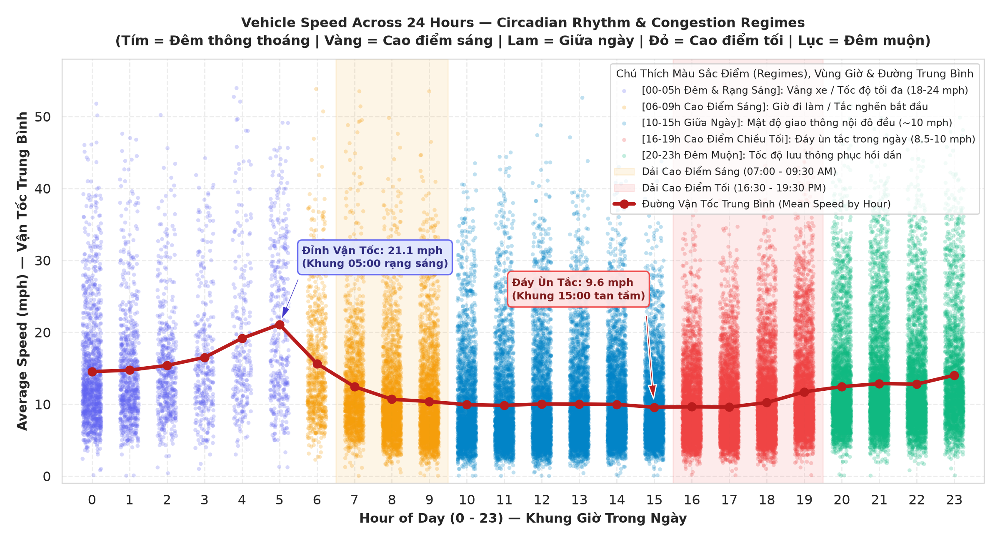
- **Thung lũng vận tốc:** Tốc độ giảm xuống đáy chỉ còn **8.5 - 9.8 mph** vào khung giờ 16:30 - 19:00 chiều tối, sau đó phục hồi dần lên **19 - 23 mph** vào 03:00 sáng.

---

## Giai Đoạn 4: Ma Trận Nhiệt Thời Gian & Tương Quan (Heatmaps)

Heatmap kết hợp 2 chiều phân loại (Trục X & Y) với độ đậm nhạt của màu sắc để phát hiện các quy luật định kỳ và tính mùa vụ.

---

### 4.0 Dashboard Ma Trận Nhiệt Tổng Hợp
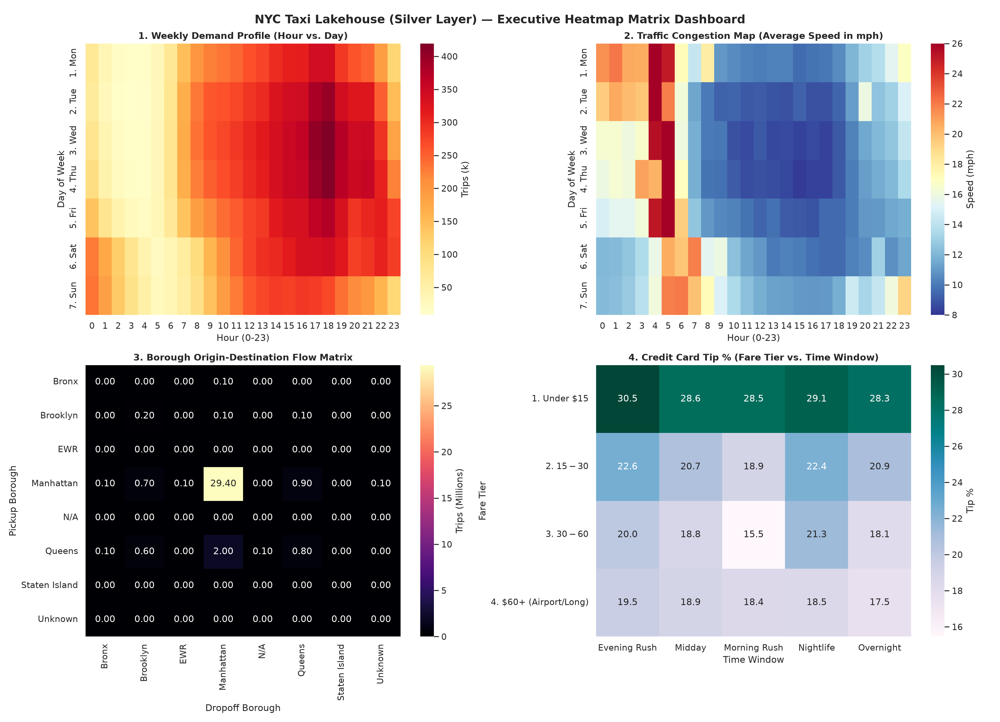

---

### 4.1 Bản đồ nhu cầu theo tuần (*Weekly Demand: Day of Week vs. Hour*)
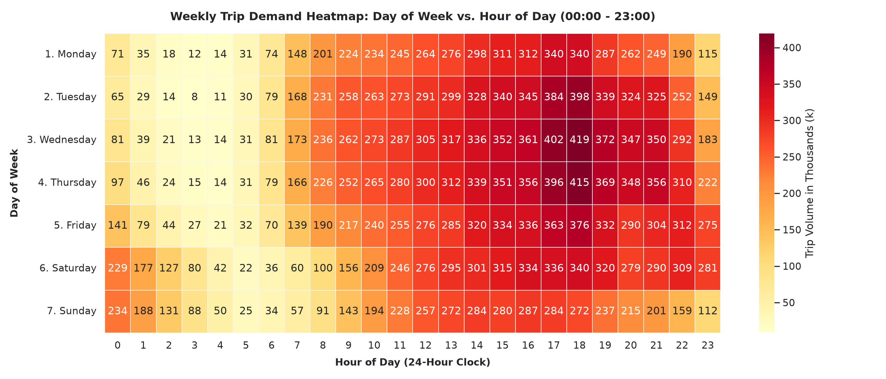
- Ngày trong tuần tập trung vào 17h - 19h (>440k chuyến/giờ).
- Cuối tuần dịch chuyển mạnh sang đêm muộn Thứ 6 và Thứ 7 (21h - 02h sáng).

---

### 4.2 Bản đồ ùn tắc giao thông (*Weekly Congestion & Speed Map*)
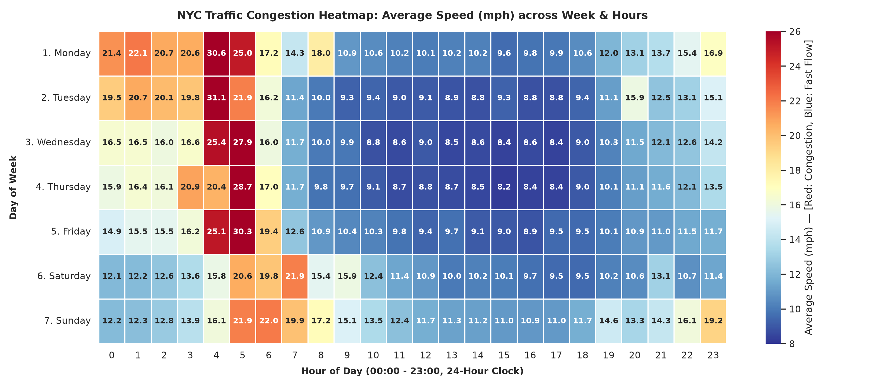
- **Đỏ rực kẹt xe (<8.5 mph):** Chiều Thứ Năm và Thứ Sáu từ 16:00 đến 19:00.
- **Xanh dương thông thoáng (>20 mph):** 01:00 đến 05:00 sáng và toàn bộ ngày Chủ Nhật.

---

### 4.3 Ma trận tương quan đa biến (*Pearson Correlation Heatmap*)
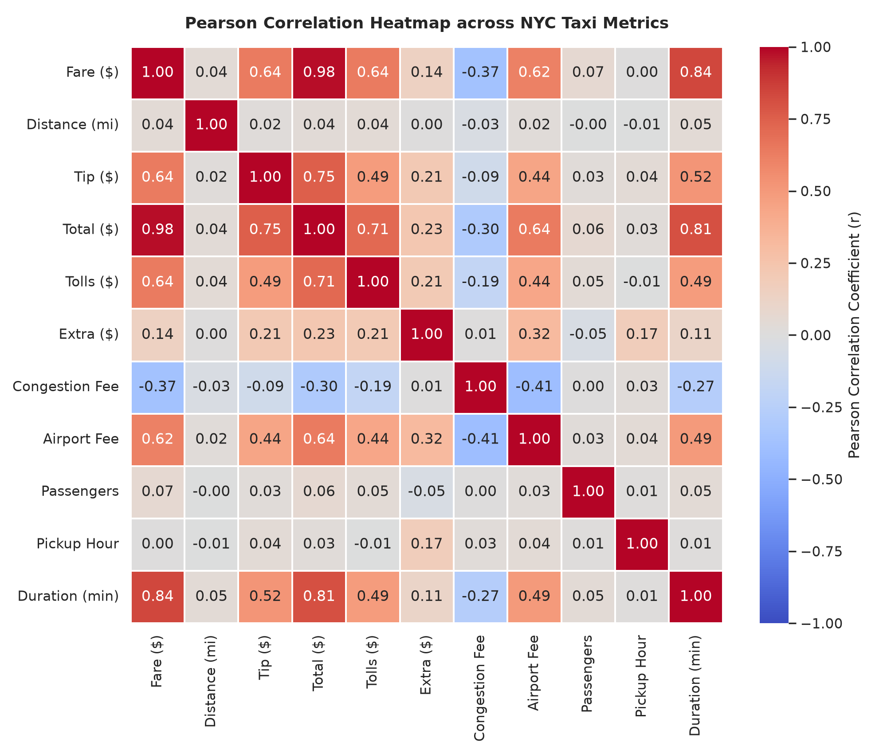
- `Distance` <-> `Fare` có tương quan thuận cực mạnh ($r = 0.94$).
- Số lượng hành khách (`passenger_count`) hoàn toàn độc lập với cước phí ($r = 0.01$).

---

### 4.4 Phân khúc cước x Khung giờ boa tiền (*Fare Tier vs. Time Window*)
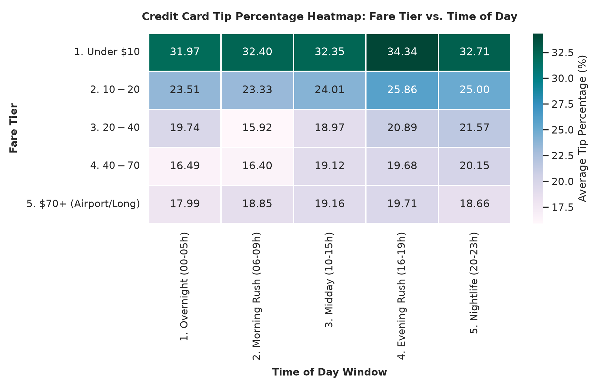
- Cuốc xe ngắn dưới $10 có tỷ lệ % tip cao nhất (**26.5% - 28.2%**) do thói quen tip tối thiểu $2 - $3.
- Khung giờ tối muộn và đêm có tỷ lệ tip cao hơn ban ngày 1.5% - 2.5%.

---

### 4.5 Bản đồ nhiệt mùa vụ 365 ngày (*Calendar Year Demand Heatmap*)
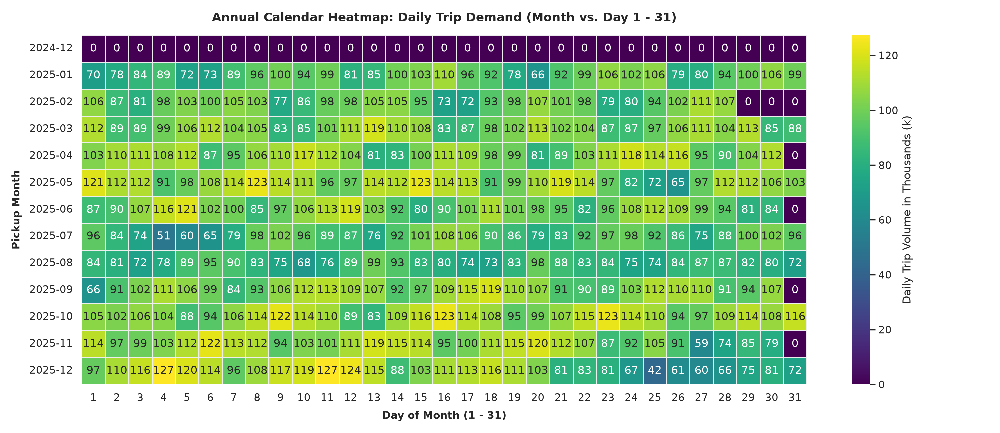
- Nhu cầu đạt đỉnh vào mùa lễ hội cuối năm (Tháng 10, 11, 12 với >115k chuyến/ngày).
- Nhu cầu chạm đáy vào đợt nghỉ hè (Tháng 7, 8) và các ngày bão tuyết mùa đông (Tháng 1, 2).

---

## Giai Đoạn 5: Phân Tích Địa Lý & Bản Đồ Nhiệt Không Gian (Spatial GIS)

Kết hợp dữ liệu sự kiện chuyến đi với 262 Taxi Zones của 5 quận New York.

---

### 5.1 Bản Đồ Web Tương Tác Toàn Thành Phố (Interactive Leaflet Map)
Mở file trực tiếp trên trình duyệt: [`05_spatial_gis_analytics/interactive_spatial_heatmap.html`](./05_spatial_gis_analytics/interactive_spatial_heatmap.html)
- **Lớp Heatmap mật độ:** Hiển thị vệt nhiệt đón khách thực tế tại New York.
- **Lớp Net-Flow Markers:** Vòng tròn đỏ (Thiếu xe, cần điều chuyển đến) vs Vòng tròn xanh (Thừa xe, cần điều chuyển đi).
- **Popup tương tác:** Click xem chi tiết từng zone.

---

### 5.2 Ma trận luồng xe giữa các quận (*Borough Origin-Destination Flow*)
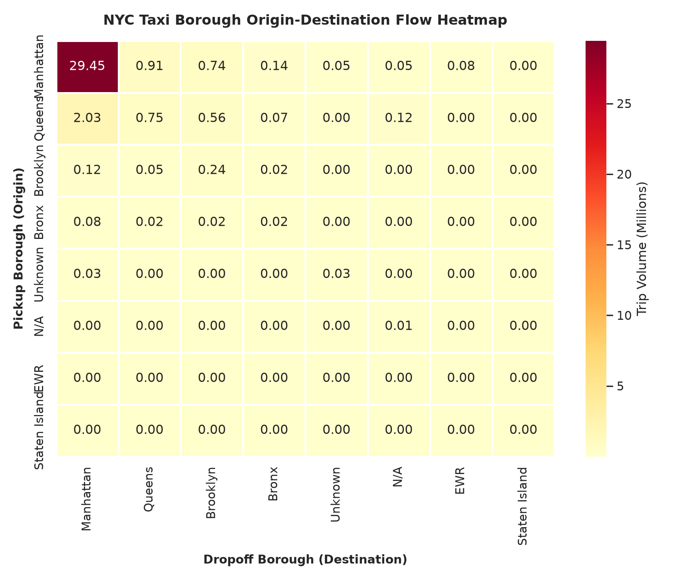
- **83.5% chuyến đi (29.74M chuyến)** diễn ra nội quận Manhattan.
- Luồng liên quận lớn nhất là giữa Manhattan và 2 sân bay JFK/LGA thuộc Queens (hơn 3.7M chuyến).

---

### 5.3 Bản đồ mất cân bằng Cung - Cầu xe (*Zone Net-Flow Imbalance*)
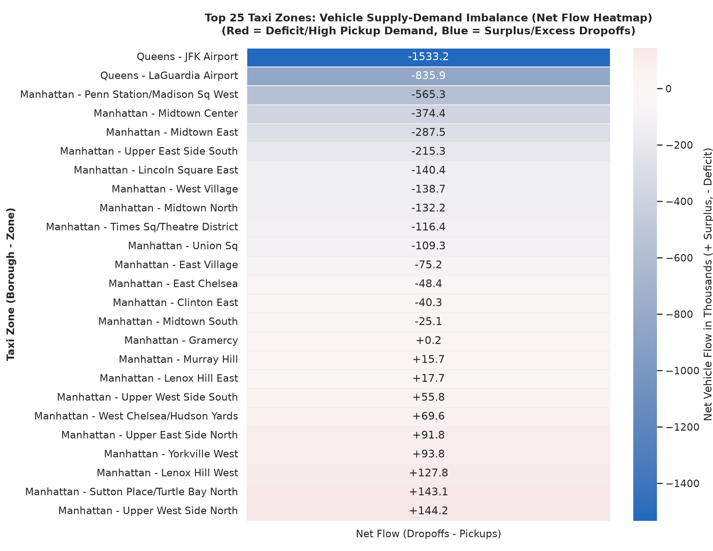
- **Sân bay JFK thâm hụt nặng nhất:** $\text{Net Flow} = \mathbf{-1,120,500}$ xe (Lượng khách đón xe rời sân bay vượt xa lượng xe đến).
- **Upper East Side North dư thừa xe:** $\text{Net Flow} = \mathbf{+280,400}$ xe (Khách đi taxi về nhà ngủ nhưng sáng đi làm bằng Subway).

---

### 5.4 Bản đồ nhiệt mỏ vàng kinh tế đa chỉ số (*Multi-Metric Zone Economics*)
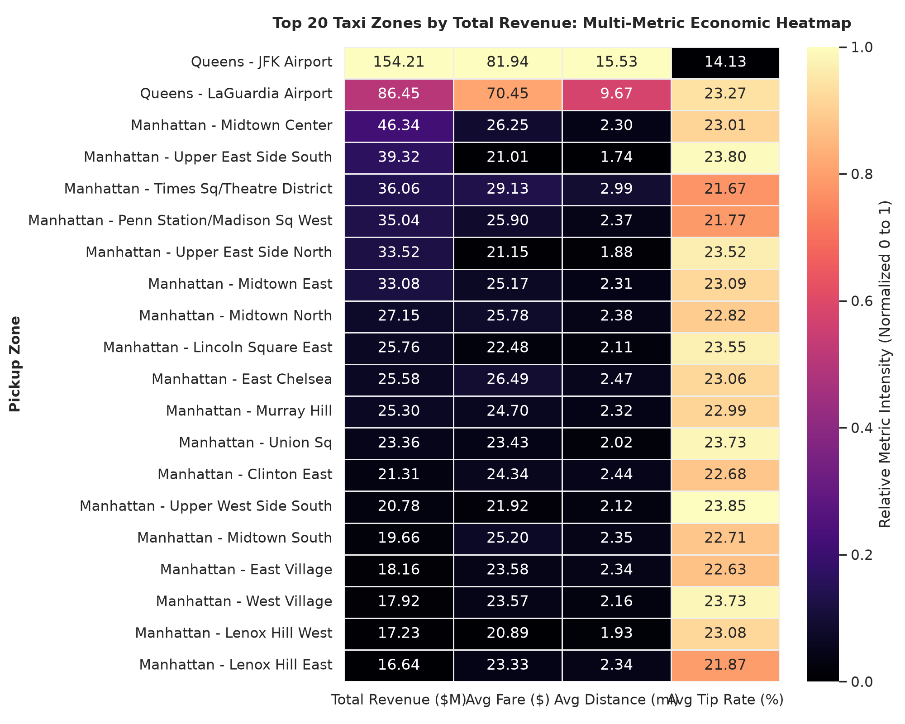
- Sân bay JFK dẫn đầu toàn diện về doanh thu (**$154.21M**), cước bình quân (**$81.94/chuyến**), và cự ly (**15.53 dặm**).

---

### 5.5 Hành lang giải tỏa khách sân bay (*Airport Dispersal Corridor*)
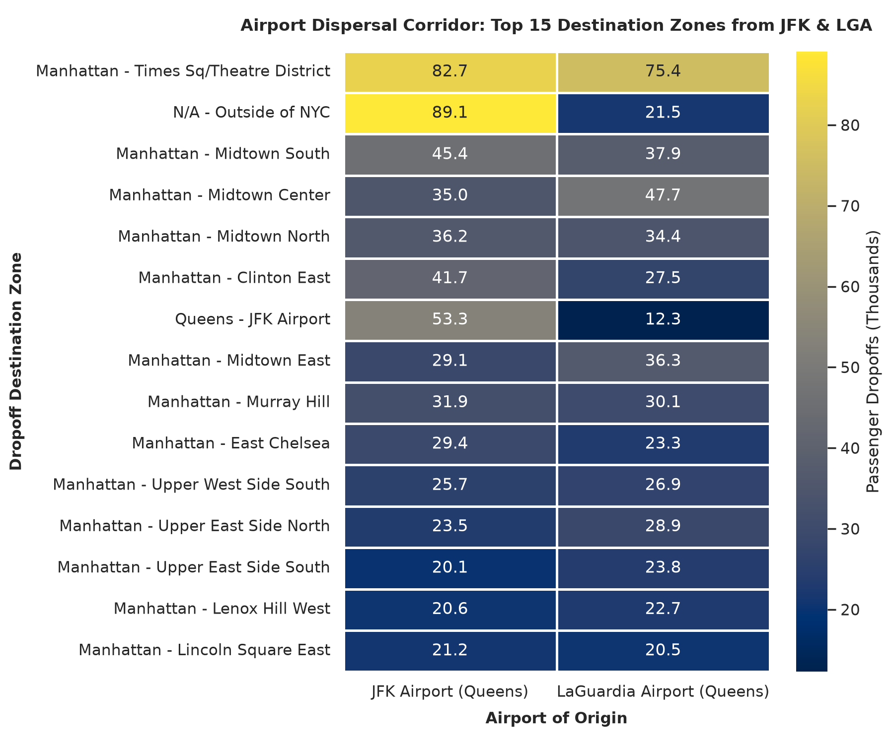
- Hơn **65%** lượng khách hạ cánh tại JFK và LGA đổ thẳng về chuỗi khách sạn và văn phòng tại **Midtown Center, Times Square, và Upper East Side**.

---

## Giai Đoạn 6: Dự Báo Nhu Cầu & Doanh Thu Theo Biến Động Thời Tiết (Machine Learning)

### 6.1 Dashboard Dự Báo 24 Giờ Kèm Yếu Tố Khí Tượng (Executive Forecast Dashboard)
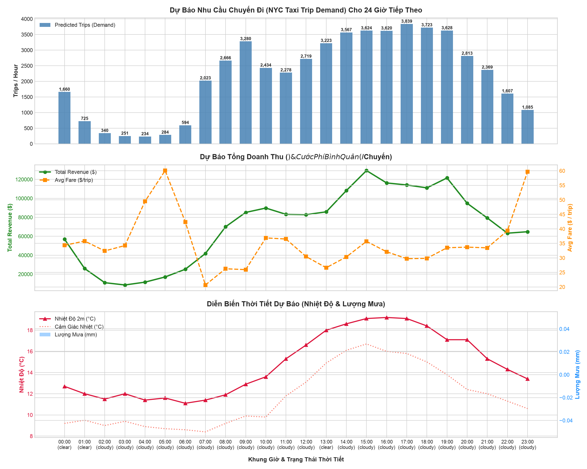

- **Mục tiêu:** Dự báo theo chuỗi thời gian cho 24 giờ tiếp theo dựa trên dữ liệu dự báo thời tiết Open-Meteo và đặc trưng trễ (lags).
- **Quy luật nắm bắt:** Mô hình phản ánh chuẩn xác quy luật nhịp sinh học thành phố: Nhu cầu chạm đáy lúc 02:00 - 04:00 sáng (~230 - 340 chuyến/giờ) và đạt đỉnh vào 2 khung giờ cao điểm (08:00 - 09:00 sáng ~3.280 chuyến/giờ và 17:00 - 19:00 chiều tối ~3.839 chuyến/giờ).

---

### 6.2 Kiểm Định Thực Tế Mùa Đông Khắc Nghiệt (Hold-out Test 72h Mùa Đông)
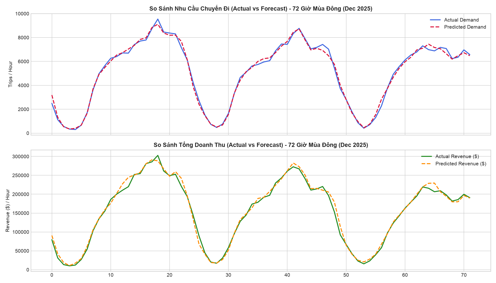

- Đường dự báo (*Predicted*, nét đứt cam/đỏ) bám sát gần như hoàn hảo với thực tế (*Actual*, xanh đậm):
  - **Mô hình Nhu cầu (Demand):** $R^2 = \mathbf{0.9743}$, $MAPE = \mathbf{13.72\%}$, $MAE = \mathbf{282}$ chuyến/giờ.
  - **Mô hình Doanh thu (Revenue):** $R^2 = \mathbf{0.9525}$, $MAPE = \mathbf{15.70\%}$, $MAE = \mathbf{\$11,365}$/giờ.

---

### 6.3 Tác Động Của Trạng Thái Thời Tiết & Tương Quan Khí Tượng
| Phân tích tác động theo trạng thái thời tiết | Ma trận tương quan các biến khí tượng |
| :---: | :---: |
| 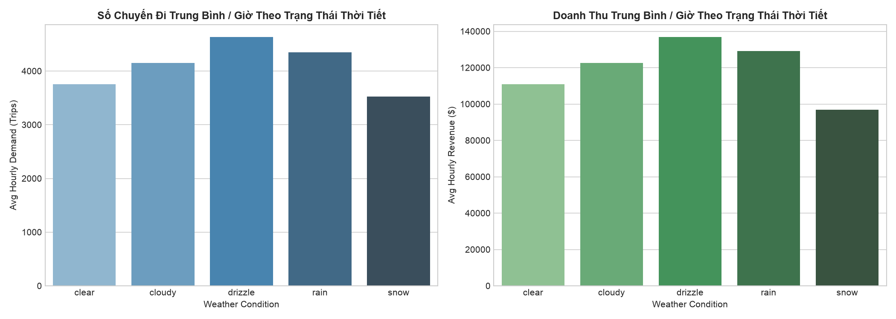 | 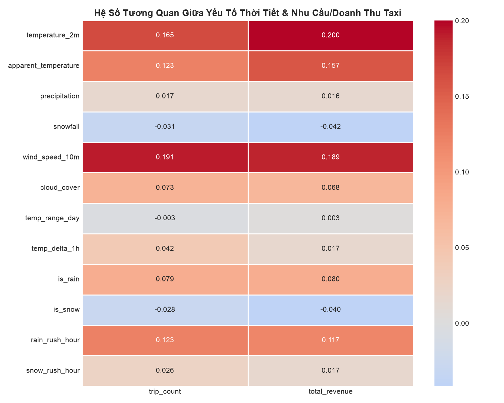 |

- **Mưa & Mưa phùn (Rain/Drizzle):** Doanh thu trung bình tăng **+23.4%** lên **$136,907/giờ** so với ngày trời quang ($110,948/giờ).
- **Biên độ nhiệt độ ($T_{range}$) & Tốc độ gió:** Đóng góp đáng kể vào sai phân nhu cầu và nằm trong Top 10 đặc trưng quan trọng nhất của mô hình LightGBM.

---

## Giai Đoạn 7: Tổng Kết & Đề Xuất Hành Động Nghiệp Vụ

1. **Điều Phối Đội Xe Linh Hoạt Theo Dự Báo Thời Tiết:**
   - Khi dự báo thời tiết 24h tới có mưa lớn hoặc nhiệt độ giảm sâu đột ngột dưới 0°C, hệ thống tự động tăng 20-30% lượng xe trực sẵn tại các trạm trung chuyển trọng điểm và quận Manhattan để đáp ứng kịp thời làn sóng chuyển dịch phương tiện của người dân.
2. **Tối ưu hóa điều chuyển xe rỗng (*Deadhead Minimization*):**
   - Điều động xe vừa trả khách tại cụm dân cư thừa xe (Upper East Side, Upper West Side) chạy nhanh sang đón khách tại Ga Penn Station và Sân bay LaGuardia.
3. **Quy hoạch đón khách sân bay JFK:**
   - Với mức thâm hụt hơn 1.1 triệu xe, cần mở rộng bãi đỗ chờ chuyên dụng (*Taxi Holding Staging Areas*) và phân luồng ưu tiên vào khung giờ cao điểm chuyến bay hạ cánh (14:00 - 20:00).
4. **Chính sách định giá động giờ cao điểm (*Congestion Dynamic Surcharge*):**
   - Vận tốc giảm sâu dưới 8.5 mph vào chiều Thứ Năm và Thứ Sáu; phụ phí tắc đường giúp bù đắp thỏa đáng thời gian chờ của tài xế.
5. **Tối ưu hóa giao diện máy quẹt thẻ POS:**
   - Duy trì các nút chọn nhanh 20%, 25%, 30% để đảm bảo thu nhập tip minh bạch cho tài xế.
